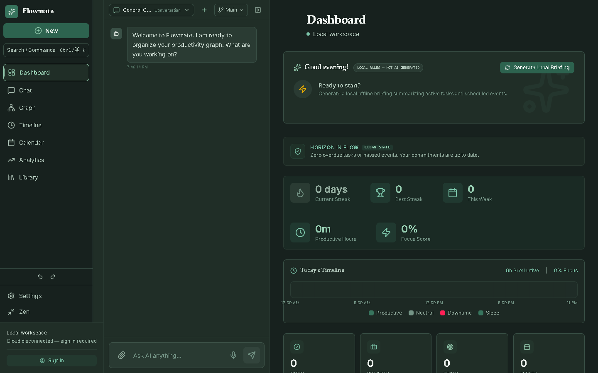
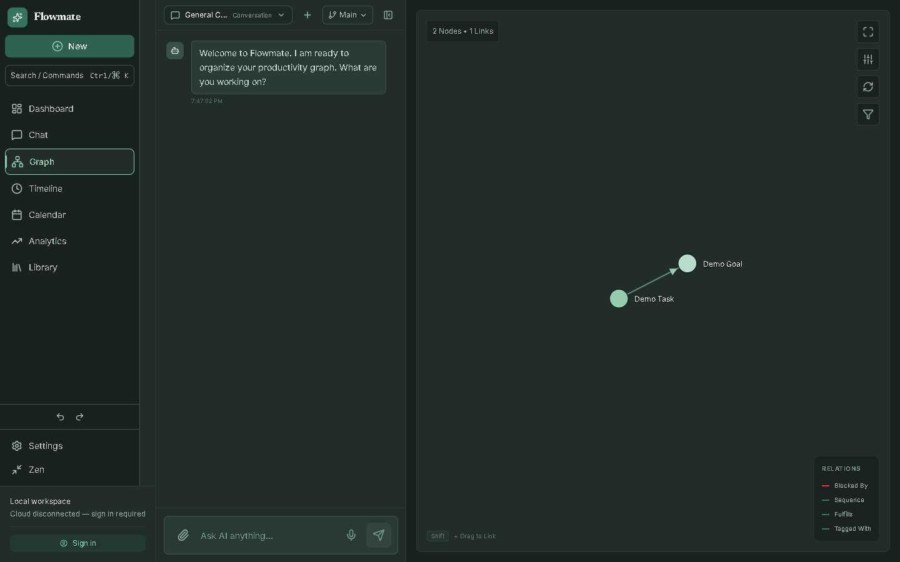

# Flowmate

Flowmate is a local-first productivity workspace for goals, projects, tasks, events, relationships, focus sessions, and conversational planning. The application can store and use workspace data locally. Optional Firebase and Gemini integrations require configuration and have not been validated against a staging provider in this release work.

## What works locally

- Create and edit goals, projects, tasks, events, habits, and relationships.
- Explore the same entities in Library, Graph, Calendar, Timeline, Dashboard, and Analytics views.
- Fork conversations into independent branches while keeping the parent history.
- Use local CRUD, calendar calculations, and the clearly labeled deterministic Dashboard briefing without a provider.
- When Gemini is not configured, chat explains that it cannot generate an AI response and points to Settings for provider configuration.
- Choose a saved visual palette in Settings.

Workspace persistence uses browser storage. The production service worker caches the application shell and static assets after a successful online visit. This does not mean provider sync is available or that an uncached route can be loaded offline. Test offline behavior on a production preview, not the Vite development server.

## Integrations and limits

Firebase sign-in and cloud sync are enabled only when the required browser configuration is present. A successful local build or configured Firebase client does not verify authentication, Firestore rules, ownership isolation, or cloud synchronization. These require a dedicated staging project and synthetic accounts.

Gemini is optional. A key entered in Settings is held in JavaScript memory for the current tab and sent from the browser to Google's Gemini API when an AI feature is used. It is not stored by this client in local storage. Treat a browser API key as exposed to the user and the browser environment; use a key with suitable restrictions and quotas. No live Gemini calls were made during this QA work. Without a key, local application features continue to work, but chat does not fabricate a provider response.

Google Calendar connection and real provider-backed behavior also require separate authorized staging validation. Do not use production accounts or personal data for release testing.

## Run locally

1. Install Node.js and npm.
2. Run `npm ci`.
3. Run `npm run dev -- --host 127.0.0.1` for local development.
4. Open the loopback URL printed by Vite.

No Firebase or Gemini configuration is required for local workspace storage, calendar, graph, and CRUD functionality. AI responses require an authorized Gemini provider key configured in Settings. Never put Firebase service-account credentials, owner keys, or billing credentials in Vite `VITE_*` variables; browser build variables are downloadable by users. Firebase client configuration is public application configuration and must be protected by Authentication and correctly scoped Firestore Security Rules.

## Verify

- `npm run check:types`
- `npm run test:run`
- `npm run check:invariants`
- `npm run build`
- `npm run release:scan`

The tests cover deterministic local behavior. They do not replace authorized Firebase/Gemini staging tests, production hosting verification, or browser testing on a production build.

## Screenshots

These screenshots show synthetic local workspace data with no connected account or provider credentials.

## Technology and architecture

The client is built with React 19, TypeScript, and Vite. Zustand maintains the canonical browser workspace state; D3 renders the relationship graph. Firebase Web SDK integrations are optional and are only enabled when a deployment supplies its public web-client configuration. The app has no custom application server in this repository. Vitest covers deterministic state and component behavior, while Playwright exercises production-build browser journeys.

## Release verification scope

The published portfolio experience is intended to work keyless with local synthetic or user-entered workspace data. Firebase authentication and cloud synchronization, Gemini responses, and Google Calendar provider behavior require separate authorized staging validation. The screenshots and local browser checks do not establish those provider-backed guarantees.
