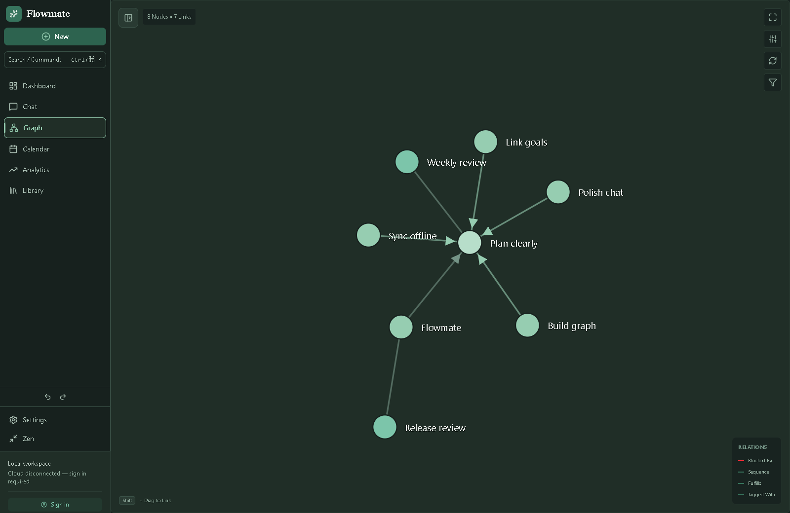

# Flowmate

> **A graph-native productivity workspace for connecting goals, projects, tasks, schedules, and the conversations around them.**

Flowmate brings planning into one navigable workspace. Its typed relationships link the work behind a goal, while Dashboard, Graph, Calendar, Analytics, and Library present the same workspace for different kinds of work.

**[Open Flowmate](https://flowmate-ai.web.app/)** · [View the source on GitHub](https://github.com/Suvichan2005/Flowmate-AI)

*Captured from the deployed application using ordinary create and link actions in an isolated, local-only synthetic workspace.*

## Why Flowmate

Goals, tasks, schedules, notes, and conversations often live in separate tools. That makes everyday planning questions difficult: which project supports a goal, what work depends on a milestone, and how do a meeting and its follow-up fit together?

Flowmate represents work as typed entities and relationships. The Graph visualizes those connections; the other views present the same workspace for planning, review, and day-to-day use.

## What you can do

- **Plan with connected records:** create and edit goals, projects, tasks, events, habits, notes, and other supported entities.
- **Explore relationships:** add typed links and inspect the workspace in an interactive D3 graph.
- **Use multiple planning views:** review work in Dashboard, Calendar, Analytics, and Library.
- **Branch conversations:** create alternate conversation paths and navigate their histories.
- **Track progress:** review project and goal progress, habits, focus sessions, and productivity summaries.
- **Personalize Flowmate:** choose among four complete palettes, with local persistence and cross-tab synchronization.
- **Work locally:** core workspace capture and views use browser storage. Optional Firebase sign-in enables cloud synchronization.

## Gemini assistance and user control

Gemini assistance is optional. A user-provided key can be entered in Settings; it stays in the active browser session and is sent from that browser to Google's Gemini API. Model-proposed workspace changes still pass through Flowmate's review and confirmation flow.

Managed Gemini is disabled in the current production build while protected App Check acceptance is unresolved. The deployed browser checks used a keyless build and made no model requests, so they do not certify a live provider response. Without an available provider, Flowmate keeps the message and reports that no AI response was generated rather than inventing one. Browser API keys are visible to the browser environment; use a suitably restricted key. Never put Gemini credentials in Vite `VITE_*` build variables or commit them.

## Architecture

Flowmate's released interface is a client-side React application. The browser stores the local workspace; signed-in Firestore sync is optional and consent-gated. User-provided Gemini keys are used directly from the browser. The managed-Gemini Function exists separately, but the current Hosting build does not call it.

~~~mermaid
flowchart LR
  User[User] --> UI[React views]
  UI --> Store[Zustand store]
  Store --> Kernel[Domain kernel and validated operations]
  Kernel --> Projections[Dashboard, Graph, Calendar, Analytics, Library]
  Store <--> Local[Browser storage]
  Store -. optional signed-in sync .-> Firebase[Firebase Auth and Firestore]
  UI -. optional user key .-> Gemini[Google Gemini API]
  Gemini --> Tools[Declared workspace tools]
  Tools --> Review[Review proposed operations]
  Review -->|user confirms| Kernel
  Review -->|user declines| Stop[No mutation]
  SW[Service worker caches application shell] --> UI
  Managed[Managed Gemini endpoint - disabled] -. gated .-> UI
~~~

## Data model and cross-view behavior

Entities represent goals, projects, tasks, events, habits, and other supported records. Typed relationships connect entity identifiers with links such as `PART_OF`, `DEPENDS_ON`, `FULFILLS`, `PRECEDES`, and `RELATED_TO`.

Validated operations update the shared workspace store. Graph, Dashboard, Calendar, Analytics, and Library project that same state, keeping changes visible across views. Browser storage provides local persistence; signed-in users can enable user-scoped Firestore synchronization after consent.

## Engineering choices

- **A shared domain model:** views project the same entities and typed relationships instead of maintaining separate feature-specific copies.
- **Review before mutation:** proposed AI operations pass through validation and user confirmation.
- **Local-first access:** workspace capture and core views remain available without a remote account.
- **Explicit integration boundaries:** Firebase synchronization and Gemini assistance have separate configuration and failure paths.

## Technology

| Area | Technologies |
| --- | --- |
| Application | React 19, TypeScript, Vite |
| State and domain | Zustand, Flowmate domain kernel, typed entity relationships |
| Visualization | D3.js, Recharts |
| Styling and icons | Tailwind CSS 4, Lucide |
| Optional cloud | Firebase Authentication, Cloud Firestore |
| Optional AI | Google Gemini via `@google/genai` |
| Verification | Vitest, Testing Library, Playwright, TypeScript, project invariants |

## Repository map

~~~text
App.tsx                  Application shell and route composition
components/              Workspace views and user interactions
services/kernel/         Domain operations and validation
services/ai/             Gemini client, context, tools, and orchestration
services/sync/           Optional cloud synchronization
services/storage/        Local persistence adapters
store.ts                 Zustand application state
store/kernelProjection.ts View projections over kernel entities
utils/calendarConflicts.ts Calendar interval conflict checks
browser-tests/           Browser acceptance journeys
tests/                   Unit and integration coverage
docs/assets/             Deployed application screenshots
~~~

## Run locally

Requirements: Node.js 20 or a current supported LTS release, plus npm.

~~~bash
git clone https://github.com/Suvichan2005/Flowmate-AI.git
cd Flowmate-AI
npm ci
npm run dev -- --host 127.0.0.1
~~~

Open the loopback URL printed by Vite. Start from `.env.example` for optional Firebase browser configuration. Never commit `.env.local`. Configure Gemini at runtime in Settings; do not put its key in the build environment.

## Verification

Run these checks from the repository root:

~~~bash
npm run test:release
npm run check:types
npm run check:invariants
npm run check:themes
npm run build
~~~

The deployed build is pinned to source commit `15e2109ad2a25cc3a15aee8ba5bac99aeabd3a73`. Its release checks passed 87 test files / 769 tests, TypeScript, project boundaries and invariants, theme checks, and a five-timezone calendar matrix (245 cases). The final candidate passed 19 real-Chrome journeys on its Hosting preview; the deployed production build then passed 8 fresh-Chrome smoke journeys covering mobile navigation and model control, responsive Settings, the collapsed-chat graph layout, keyless provider isolation, and offline shell recovery. Two synthetic D3 harness tests passed against source because that test harness is excluded from production assets. No signed-in account, Firestore write, or Gemini generation was used in these browser passes.

Google sign-in, production Firestore synchronization, every Firebase security-rule scenario, managed Gemini generation, and multi-user collaboration were not established by these checks.

## Security and limitations

- Firebase browser configuration is public client configuration, not an authorization secret. Protect user data with Firebase Authentication and backend security rules.
- A Hosting preview connected to the production Firebase project still uses that backend; use synthetic accounts and records for provider testing.
- Managed Gemini is disabled in this deployment. BYOK requires a user-configured runtime key and network access; treat browser keys as exposed to the browser and restrict their API access and quota.
- Local data is browser-profile-specific until optional cloud synchronization is configured.
- This release is a personal productivity workspace, not a hosted team collaboration service.

## Future direction: Flowmate Next

Flowmate Next is a product and research direction, not a capability claim about this deployed web release. It explores richer contextual memory and more capable assistance while the live Flowmate Web application remains the feature set described above.

## License

Flowmate is available under the MIT License. See [LICENSE](LICENSE).
