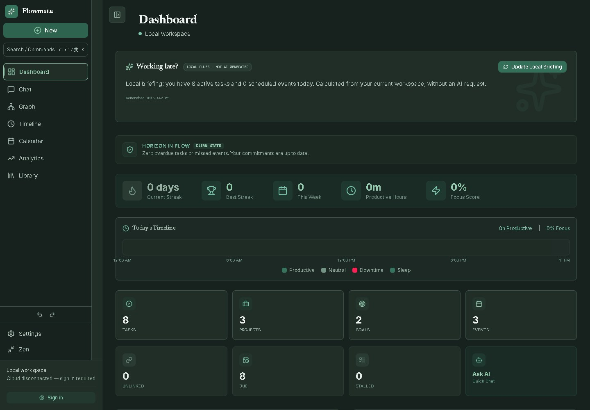
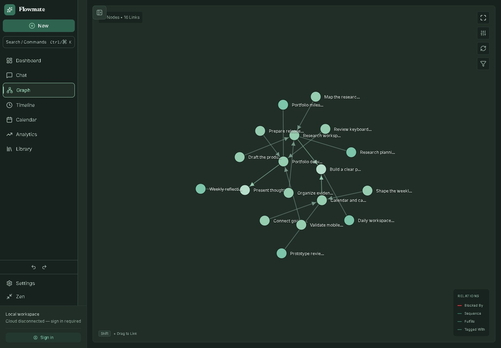
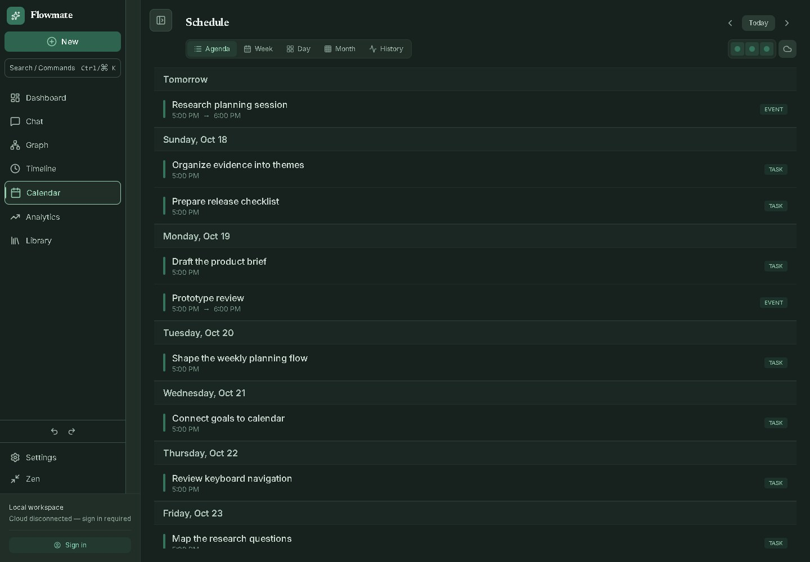
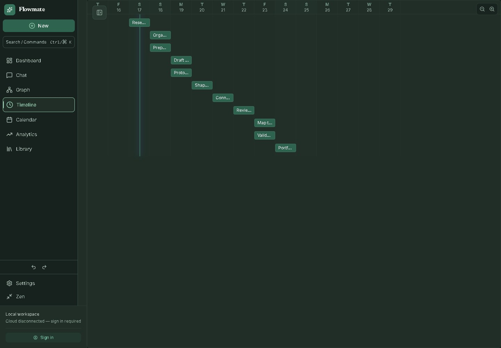
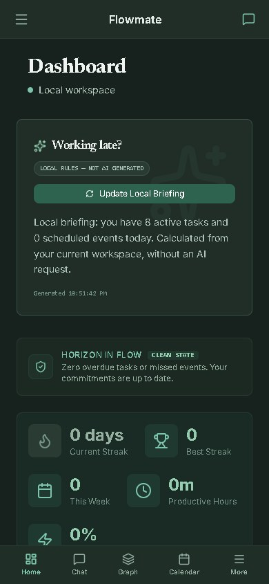

# Flowmate

> **A graph-native productivity workspace that connects goals, projects, tasks, time, and the context behind them.**

Flowmate is built around a simple idea: plans become more useful when the work, deadlines, habits, and conversations around them stay connected. Instead of maintaining separate lists and calendars, Flowmate lets a person build one navigable workspace and follow those relationships across several views.

**[Open the live application](https://flowmate-ai.web.app/)** · [Browse the source](https://github.com/Suvichan2005/Flowmate-AI)

## Product tour

These are authentic screenshots of the deployed release, captured at 8ac628713c37eb645f985e18631381f30ae20405. The showcase data was entered through Flowmate’s ordinary create and relationship controls in a local browser workspace: 18 synthetic entities and 16 links. No fixture mode, injected records, personal account data, or generated AI response was used. The dashboard briefing is explicitly labeled as local rules.

### A workspace at a glance

### Explore connected work

### Work across time

### Designed for a compact screen

## The problem Flowmate explores

Goals, tasks, schedules, notes, and conversations are usually stored in different tools. That split makes it harder to answer practical questions: Which project supports this goal? What depends on the task I am postponing? Does a meeting belong to the same initiative as the work around it?

Flowmate models useful work as entities connected by typed relationships. The graph is the underlying organizing model; Dashboard, Graph, Calendar, Timeline, Analytics, and Library are different ways to inspect or act on that shared workspace.

## What is implemented

- **Capture and organize:** create and edit goals, projects, tasks, events, habits, and other supported entities.
- **Relationship-aware workspace:** connect records with typed links and inspect them in the interactive D3 graph.
- **Dashboard:** review workspace counts, upcoming work, focus information, and an on-demand local briefing calculated from current records.
- **Calendar and timeline:** inspect dated work in agenda/calendar and timeline views; scheduling conflict checks are available in the client.
- **Conversation history:** keep multiple conversations, branch alternate paths, and retain drafts per branch.
- **Analytics and habits:** see habit and productivity summaries derived from workspace records.
- **Personalize the interface:** switch among four palettes; theme state is persisted locally and synchronized between open tabs.
- **Work offline:** core workspace operations are local. After the application shell has been cached by a successful online visit, the service worker supports offline reloads.

The removed recruiter demo/sample workspace is not part of the application.

## AI assistance and user control

Flowmate’s optional Gemini integration uses Google’s @google/genai client from the browser. The assistant can receive workspace context and use declared tools to query or propose changes. Proposed mutations are presented for review through the operations preview; the model does not directly commit a state-changing operation without user confirmation.

Gemini is **not required** for local workspace use. Without a runtime key, Flowmate saves the user’s message and explains that it did not generate an AI response. Local briefings are deterministic calculations and are labeled as such.

The deployed build contains no Gemini key. A user who chooses to enable Gemini supplies a key in Settings for the active browser session; the client keeps it in memory and sends requests directly to Google. Do not place personal, privileged, or billing credentials in a VITE_* variable or commit them to this repository. A live Gemini response was not verified for this release, so the screenshots intentionally make no live-AI claim.

## System architecture

The web application is a client-side React app. It has no application server in this release. Local use does not require Firebase or Gemini configuration.

~~~mermaid
flowchart LR
  User[User] --> UI[React views]
  UI --> Store[Zustand store]
  Store --> Kernel[Domain kernel and validated operations]
  Kernel --> Projection[Read projections for graph, dashboard, calendar, timeline]
  Store <--> Local[Browser local storage]
  Store -. optional signed-in sync .-> Firebase[Firebase Auth and Firestore]
  UI -. optional user-provided runtime key .-> Gemini[Google Gemini API]
  Gemini --> Tools[Declared workspace tools]
  Tools --> Preview[Review proposed changes]
  Preview -->|user confirms| Kernel
  Preview -->|user declines| Stop[No mutation]
  SW[Service worker caches app shell] --> UI
~~~

Firebase is an optional client integration for authentication and cloud synchronization. The Firebase browser key is public client configuration, not an authorization secret; access to user data depends on Firebase Authentication and backend security rules. Gemini requests are a separate, optional provider path. Local operations continue when either provider is unavailable.

## Data model and cross-view behavior

The kernel is the canonical in-memory domain state. Entities carry schema identity and version, a title, typed attributes, lifecycle information, and provenance where available. Relationships connect entity identifiers using typed edges such as PART_OF, DEPENDS_ON, FULFILLS, PRECEDES, and RELATED_TO.

Validated operations update the workspace store; view-facing projections let Dashboard, Graph, Calendar, Timeline, and Library present the same underlying records for their use. Local persistence is browser storage. When a user signs in and Firebase is configured, the optional sync layer reconciles user-scoped entity and relationship data with Firestore.

The live Hosting preview was smoke-tested with a synthetic Firebase account: email/password account creation succeeded, an entity was created through the UI, and it reappeared after signing in from a clean browser context. This is a bounded integration smoke test, not a claim that every account flow, rules scenario, or production user path has been tested.

## Engineering decisions

- **One connected workspace:** shared entities and typed links let multiple views represent the same work instead of maintaining separate feature-specific copies.
- **Review before mutation:** provider output is treated as a proposal; the application’s operation pipeline validates and applies only user-confirmed changes.
- **Local availability first:** core capture and workspace views do not depend on a model call or remote account.
- **Explicit provider boundaries:** Firebase sync and Gemini assistance are optional network integrations with separate configuration and failure behavior.
- **Evidence over feature claims:** the screenshots use real app controls and generated synthetic records; unverified provider behavior is called out instead of implied.

## Technology

| Area | Technologies |
| --- | --- |
| Application | React 19, TypeScript, Vite |
| State and domain | Zustand, Flowmate domain kernel, typed entity relationships |
| Visualization | D3.js, Recharts |
| Styling and icons | Tailwind CSS 4, Lucide |
| Optional cloud | Firebase Authentication, Cloud Firestore |
| Optional AI | Google Gemini via @google/genai |
| Verification | Vitest, Testing Library, Playwright, TypeScript, project invariants |

## Repository map

~~~text
App.tsx                  Application shell and route composition
components/              Workspace views and user interactions
services/kernel/         Canonical domain operations and validation
services/ai/             Gemini client, context, tools, and orchestration
services/sync/           Optional cloud synchronization
services/storage/        Local persistence adapters
store.ts                 Zustand application state
store/kernelProjection.ts View projections over kernel entities
utils/calendarConflicts.ts Calendar interval conflict checks
browser-tests/           Browser acceptance journeys
tests/                   Unit and integration coverage
docs/assets/             Deployed application screenshots
~~~

## Run locally

### Requirements

- Node.js 20 or a current supported LTS release
- npm

### Start the local application

~~~bash
git clone https://github.com/Suvichan2005/Flowmate-AI.git
cd Flowmate-AI
npm ci
npm run dev -- --host 127.0.0.1
~~~

Open the local URL printed by Vite (the project config uses port 3000).

The workspace runs without secrets or provider setup. Optional Firebase configuration uses the public client values in .env.local; start from .env.example. Never commit .env.local. Gemini can be configured at runtime through Settings when a suitable restricted key is available; do not place it in the build environment.

## Verification

Run the checks from the repository root:

~~~bash
npm run test:release
npm run check:types
npm run check:invariants
npm run check:themes
npm run build
~~~

The release acceptance pass also exercised the deployed site in Chromium: workspace CRUD and cross-view persistence, conversations and branching controls, keyless provider messaging, service-worker offline reload, responsive layouts, and all four themes. Firebase Authentication and Firestore were smoke-tested on the isolated Hosting preview with synthetic data. The production deployment was then verified at the live Hosting URL.

These checks do not establish live Gemini behavior, Google sign-in, Google Calendar integration, every Firebase security-rule case, or multi-user collaboration.

## Security and limitations

- Browser-delivered Firebase configuration and Gemini runtime keys are visible to the browser; do not treat them as server secrets.
- Firebase data access must be protected by the project’s Authentication and Security Rules. A Hosting preview pointed at the production Firebase project still uses that backend, so provider tests should use synthetic accounts and records.
- Gemini requires a user-supplied runtime key and an active network connection. No Gemini response was generated or verified during this deployment.
- Google sign-in and Google Calendar behavior were not included in this release acceptance pass.
- Local browser storage is device- and browser-profile-specific until optional cloud sync is configured.
- This release is a personal productivity workspace, not a hosted team collaboration service.

## Future direction: Flowmate Next

Flowmate Next is a research and product direction, not a capability claim about this deployed web release. Areas under exploration include richer contextual memory, deeper connections between ongoing work and user intent, and more capable reviewable assistance. The live Flowmate Web application remains the feature set described and verified above.

## License

Flowmate is available under the MIT License. See [LICENSE](LICENSE).